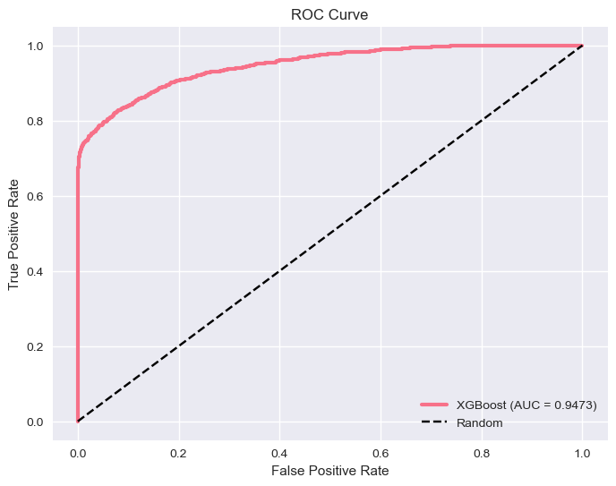
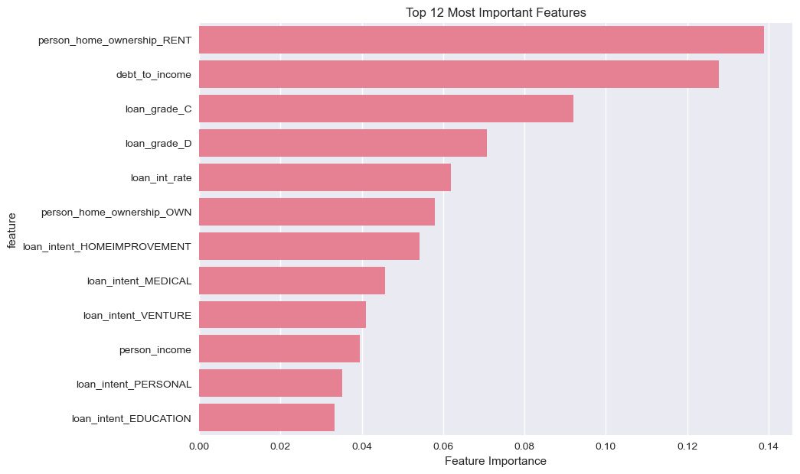

# Credit Risk Assessment

Predicts whether a loan will default from the borrower's finances and the
loan's terms, using XGBoost on 32,581 real loans.

**Dataset:** [Credit Risk Dataset by laotse (Kaggle)](https://www.kaggle.com/datasets/laotse/credit-risk-dataset),
included in this repo as `credit_risk_dataset.csv`. 21.8% of the loans
defaulted.
**Target:** `loan_status` (1 = default, 0 = repaid)

## Results

On a stratified 20% test set (6,515 loans the model never saw):

| Measure | Value |
|---|---|
| ROC AUC | **0.947** |
| Accuracy | 0.93 |
| Defaults caught (recall) | 0.72 |
| Flagged loans that did default (precision) | 0.97 |

The model is very precise when it flags a default, but it misses 28% of
defaults. For lending, where a missed default costs more than a wrongly
declined loan, lowering the decision threshold would trade some precision
for more defaults caught. That is the next step.



## What the notebook does

`credit_risk_assessment.ipynb`, run top to bottom with outputs saved:

1. **Exploration:** the default rate, and how default varies with loan
   grade, interest rate, income and home ownership.
2. **Cleaning:** fills missing employment length and interest rate with the
   median, and drops impossible records (age over 100, employment over 60
   years).
3. **Features:** adds debt-to-income and income per year employed. The
   debt-to-income ratio turned out to be nearly the same as the dataset's
   existing `loan_percent_income` column (correlation 0.999), so it adds
   little new information.
4. **Model:** a scikit-learn pipeline that scales the numeric columns,
   one-hot encodes the categorical ones and trains XGBoost (200 trees, depth
   6). The scaler and encoder are fitted on the training set only.
5. **Evaluation:** ROC AUC, a classification report, a confusion matrix and
   the ROC curve.
6. **Interpretation:** feature importance.



The strongest signals are renting rather than owning a home, debt relative
to income, loan grades C and D, and the interest rate.

## How to run it

```bash
pip install -r requirements.txt
jupyter notebook credit_risk_assessment.ipynb
```

## Limits

- One train/test split with fixed settings; no cross-validation or tuning.
- Only XGBoost is trained. Logistic regression and KNN are imported but not
  yet compared.
- No class rebalancing is applied (SMOTE is imported but not used).
- The medians used to fill missing values are computed on all rows before
  the split, a small leak.

## Author

Tiiso Letsapa, Letsapamyron07@gmail.com
